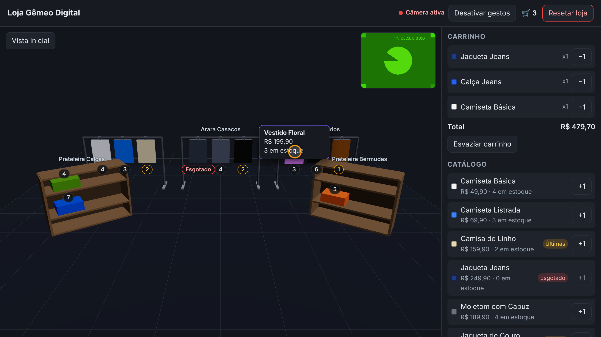

# Loja Gêmeo Digital

**Uma loja de roupas simulada em 3D, em que o estoque reage a cada peça escolhida, com seleção por gesto de mão pela webcam.**

🔗 **[Abrir a demo ao vivo](https://rodrigosilvacio.github.io/claude-sdd/)**: use um navegador com webcam, clique em **✋ Ativar gestos** e faça uma pinça sobre uma peça.



---

## O que é

Um **gêmeo digital** de uma loja física: araras, prateleiras e peças em 3D, com o estoque de cada peça visível em tempo real. A pessoa aponta para uma peça com o dedo, faz uma pinça e vê o estoque cair na hora, na cena, no catálogo e no carrinho.

| Capacidade | O que faz |
|---|---|
| 🧵 **Estoque e carrinho** | Selecionar baixa 1 unidade, remover devolve, peça esgotada não pode ser escolhida |
| 🏬 **Gêmeo digital 3D** | Loja navegável com saldo, aviso de "Últimas" e "Esgotado" em cada peça |
| ✋ **Visão computacional** | O dedo indicador move o cursor, e a pinça seleciona uma unidade por gesto |
| 🔒 **Privacidade (LGPD)** | Câmera desligada por padrão, vídeo processado só no navegador, nada gravado nem enviado |

**Para quem:** executivos e conselheiros em workshops de IA, líderes de tecnologia avaliando Spec-Driven Development e facilitadores de eventos que precisam de uma demo prática que roda direto no navegador.

## Por que este repositório existe

O `claude-sdd` avalia sabores de **Spec-Driven Development (SDD)**: desenvolvimento em que a especificação vem antes do código e guia a implementação. A Loja Gêmeo Digital é o caso de teste do sabor **[OpenSpec](https://openspec.dev)**: foi explorada, especificada, planejada e implementada pelo fluxo do OpenSpec, com cada requisito ligado a cenários testáveis.

```
/openspec-explore  -->  /openspec-propose  -->  /openspec-apply-change  -->  /openspec-archive-change
  (explorar ideia)      (proposta, specs,        (implementar e testar)       (consolidar specs)
                         design e tarefas)
```

## Status

| | |
|---|---|
| **Produto** | MVP no ar no GitHub Pages |
| **Qualidade** | 70 testes unitários e de componente, 14 de ponta a ponta (inclui um teste de privacidade com o detector real) |
| **Especificação** | change `loja-estoque-mvp` válida no `openspec validate --strict` |
| **Pendente** | validar os gestos com webcam e mão reais, depois arquivar a change no OpenSpec |
| **Próximo passo em estudo** | estoque compartilhado entre visitantes com Supabase |

## Estrutura

```
claude-sdd/
+-- README.md                      <- você está aqui
+-- CLAUDE.md                      <- instruções para o agente (Claude Code)
+-- .github/workflows/pages.yml    <- lint, testes, build e publicação no GitHub Pages
+-- openspec-sdd/                  <- sabor OpenSpec
    +-- openspec/
    |   +-- changes/loja-estoque-mvp/   <- proposta, design, tarefas e specs
    +-- app/                            <- código da Loja Gêmeo Digital
        +-- README.md                   <- página completa do produto
        +-- docs/desenvolvimento.md     <- guia técnico
```

## Rodar localmente

```bash
cd openspec-sdd/app
npm install
npm run dev
```

Depois abra http://localhost:5173.

## Saiba mais

| Documento | Conteúdo |
|---|---|
| [Página do produto](openspec-sdd/app/README.md) | personas, regras de negócio, arquitetura, métricas e roadmap |
| [Guia de desenvolvimento](openspec-sdd/app/docs/desenvolvimento.md) | scripts, testes, gestos e publicação |
| [Proposta](openspec-sdd/openspec/changes/loja-estoque-mvp/proposal.md) | por que o produto existe e o que está fora do escopo |
| [Design técnico](openspec-sdd/openspec/changes/loja-estoque-mvp/design.md) | decisões, alternativas e riscos |
| [Tarefas](openspec-sdd/openspec/changes/loja-estoque-mvp/tasks.md) | plano de implementação e pendências |

**Stack:** React, TypeScript, Vite, Zustand, Three.js (React Three Fiber), MediaPipe Hands e GitHub Pages.
