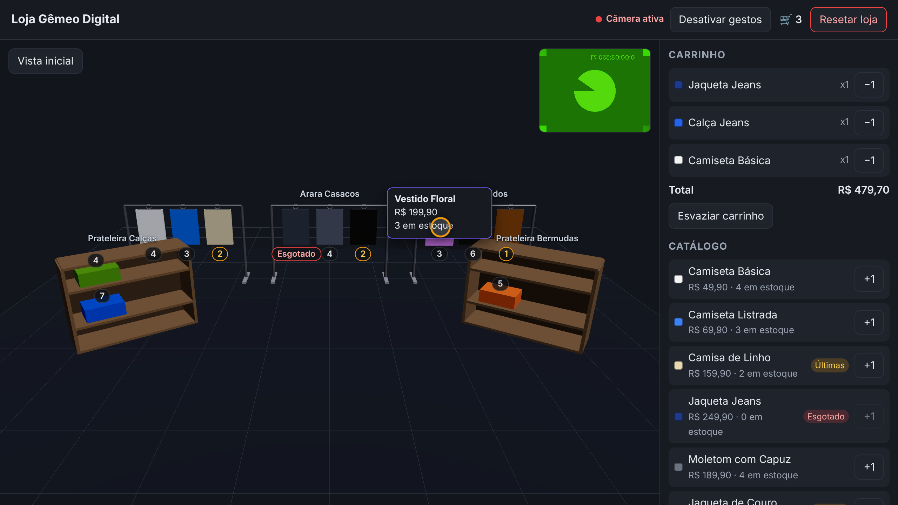

# Loja Gêmeo Digital

**Uma loja de roupas simulada em 3D, em que o estoque reage a cada peça escolhida, com seleção por gesto de mão pela webcam.**

🔗 **Demo ao vivo:** [rodrigosilvacio.github.io/claude-sdd](https://rodrigosilvacio.github.io/claude-sdd/), publicada no GitHub Pages. Abra num navegador com webcam, clique em **✋ Ativar gestos** e faça uma pinça sobre uma peça.



*Captura com câmera simulada: o cursor de mão (círculo âmbar) aponta o Vestido Floral, a Jaqueta Jeans aparece esgotada na cena e no catálogo, e o carrinho soma R$ 479,70.*

---

## Resumo executivo

| | |
|---|---|
| **O que é** | Gêmeo digital de uma loja física: araras, prateleiras e peças em 3D, com o estoque de cada peça visível em tempo real |
| **O que demonstra** | Três capacidades num só produto: regra de negócio de estoque, visualização espacial (gêmeo digital) e interação por visão computacional (mapeamento de mãos) |
| **Para que serve** | Laboratório para avaliar Spec-Driven Development com OpenSpec e vitrine prática de IA aplicada para workshops e eventos |
| **Status** | MVP no ar no GitHub Pages, com 84 testes automatizados. Falta validar os gestos com webcam e mão reais |
| **Custo de operação** | Zero: site estático no GitHub Pages, sem servidor e sem banco de dados |

## Por que este produto existe

Falar de gêmeo digital e visão computacional costuma ficar no slide. Este produto coloca as duas coisas na mão de quem está assistindo: a pessoa aponta para uma peça, faz uma pinça com os dedos e vê o estoque cair na hora, na cena 3D, no catálogo e no carrinho.

Ele também é o caso de teste do repositório `claude-sdd`: foi especificado, planejado e construído pelo fluxo OpenSpec (explorar, propor, aplicar). Assim, mostra na prática como uma especificação vira código verificável.

## Para quem

| Persona | O que ela quer | Como o produto entrega |
|---|---|---|
| **Executivo ou conselheiro em workshop** | Entender gêmeo digital e IA sem jargão | Experimenta com a própria mão em menos de um minuto |
| **Líder de tecnologia ou CTO** | Avaliar se SDD e vibe coding geram software sério | Specs, design, tarefas e testes rastreáveis lado a lado |
| **Time de produto ou dados** | Um exemplo concreto de regra de negócio testável | Estoque com invariante garantida por teste de propriedade |
| **Facilitador de evento** | Demo que funciona sem instalar nada | Abre no navegador sem instalar nada, e o botão "Resetar loja" prepara a próxima pessoa |

## Como funciona

```
+---------------------+     +-----------------------+     +--------------------+
|  1. VER             |     |  2. ESCOLHER          |     |  3. ACOMPANHAR     |
|  Loja em 3D com     | --> |  Mouse, toque ou      | --> |  Estoque baixa na  |
|  araras, prateleiras|     |  pinça com a mão      |     |  cena, no catálogo |
|  e saldo por peça   |     |  pela webcam          |     |  e no carrinho     |
+---------------------+     +-----------------------+     +--------------------+
```

### 1. Gêmeo digital da loja
- 3 araras e 2 prateleiras com 12 peças, cada uma no seu lugar.
- Cada peça mostra o saldo: normal, **"Últimas"** (1 ou 2 unidades, em âmbar) ou **"Esgotado"** (peça acinzentada).
- Dá para girar e aproximar a câmera, e "Vista inicial" volta ao enquadramento original.
- Passar o ponteiro sobre uma peça mostra nome, preço e saldo.

### 2. Seleção por gesto (visão computacional)
- **Aponte** com o dedo indicador: um cursor segue a sua mão, como num espelho.
- **Faça uma pinça** (polegar com indicador) para selecionar a peça sob o cursor.
- O cursor muda de cor quando a pinça está quase fechada e quando é reconhecida.
- Uma pinça vale **uma** unidade, mesmo que você mantenha os dedos fechados.

### 3. Estoque e carrinho
- Selecionar baixa 1 unidade do estoque e adiciona 1 ao carrinho.
- Remover do carrinho devolve a unidade ao estoque.
- Peça esgotada não pode ser selecionada, por nenhum meio.
- O estado fica salvo no navegador, e "Resetar loja" volta tudo ao estoque inicial.

## Regras de negócio

| Regra | Comportamento |
|---|---|
| Baixa ao selecionar | Cada seleção aceita reduz o saldo em exatamente 1 |
| Bloqueio por esgotamento | Saldo zero recusa a seleção e mostra "Esgotado" |
| Devolução | Remover do carrinho devolve exatamente 1 unidade |
| Conservação | Para toda peça, **saldo + carrinho = estoque inicial**, sempre |
| Uma seleção por gesto | A pinça só volta a valer depois de abrir os dedos e de 0,6 s |
| Concorrência local | Duas seleções simultâneas na última unidade: só uma é aceita |

A especificação completa, com cenários Given/When/Then, está nas specs da change ([links abaixo](#documentação)).

## Privacidade e governança (LGPD)

A câmera é o ponto mais sensível do produto, então ela foi tratada como requisito, e não como detalhe:

- **Desligada por padrão.** Só liga depois de um aviso em linguagem simples e de um clique da pessoa.
- **Processamento 100% local.** O modelo de detecção de mãos roda no navegador. O modelo e o motor são servidos pelo próprio site, sem serviços de terceiros.
- **Nada é gravado nem enviado.** Nenhuma imagem, quadro de vídeo ou coordenada da mão sai do dispositivo ou fica salva. Só o estoque e o carrinho ficam no navegador.
- **Desligar é imediato.** "Desativar gestos" libera a câmera na hora.
- **Verificado por teste.** Um teste automatizado liga o detector real e confirma que não há nenhuma requisição externa e nenhum dado das mãos armazenado.
- **Sempre há alternativa.** Se a câmera for negada ou não existir, a loja explica o motivo e continua funcionando com mouse e toque.

## Arquitetura em uma página

```
                    Navegador do visitante (nenhum servidor)
 +---------------------------------------------------------------------+
 |                                                                     |
 |  Webcam --> MediaPipe Hands --> pipeline de gestos --+              |
 |            (roda local)        (cursor + pinça)      |              |
 |                                                      v              |
 |  Mouse / toque ---------------------------> camada de ponteiro      |
 |                                              unificada              |
 |                                                      |              |
 |                                                      v              |
 |                                  regras de estoque (funções puras)  |
 |                                                      |              |
 |               +----------------------+---------------+              |
 |               v                      v               v              |
 |          Cena 3D                 Carrinho     localStorage          |
 |    (gêmeo digital)             e catálogo   (estoque e carrinho)    |
 +---------------------------------------------------------------------+
          ^
          |  site estático (HTML, JS, modelo de mãos)
     GitHub Pages  <--  GitHub Actions (lint, testes, build, deploy)
```

**Stack:** React, TypeScript, Vite, Zustand, Three.js (React Three Fiber) e MediaPipe Hands. Publicação no GitHub Pages via GitHub Actions.

A decisão central é que **mouse, toque e mão passam pela mesma camada de ponteiro e pelas mesmas regras de estoque**. Não existe um caminho "especial" para o gesto, e por isso as regras valem igualmente para qualquer forma de interação.

## Qualidade

| Verificação | Resultado |
|---|---|
| Testes unitários e de componente | 70 passando |
| Testes de ponta a ponta no navegador | 14 passando (cena 3D, gestos, privacidade) |
| Teste de propriedade da regra de conservação | 300 sequências aleatórias de operações por execução |
| Validação da especificação (`openspec validate --strict`) | válida |
| Pipeline de publicação | lint, testes e build a cada alteração |

## Métricas de sucesso (propostas)

Ainda não há medição de uso. Para avaliar o produto em workshops e eventos, a proposta é acompanhar:

| Métrica | Tipo | Meta sugerida |
|---|---|---|
| Tempo até a primeira seleção por gesto | adoção | menos de 60 s |
| Taxa de pinças reconhecidas na primeira tentativa | qualidade | 80% ou mais |
| Seleções acidentais (desfeitas em até 5 s) | qualidade | menos de 10% |
| Participantes que ativaram os gestos | engajamento | 70% ou mais |

Medir isso exige registrar eventos de uso, o que hoje está fora do escopo (veja o roadmap).

## Status e roadmap

**Agora (MVP)**
- [x] Estoque com baixa, devolução, bloqueio, esvaziar e resetar
- [x] Gêmeo digital 3D sincronizado em tempo real
- [x] Seleção por pinça com mapeamento de mãos local
- [x] Publicação automatizada no GitHub Pages (fonte: GitHub Actions)
- [ ] Validação com webcam e mão reais (pinça, duas mãos e roteiro de demo completo)
- [ ] Arquivar a change no OpenSpec, transformando as specs em fonte oficial da verdade

**Próximo (a decidir)**
- **Estoque compartilhado com Supabase:** todos os visitantes veem a mesma loja, e quem pega a última peça esgota a peça para todos. Isso exige baixa atômica no banco, reserva com expiração no carrinho e proteção contra abuso.
- **Métricas de uso** para medir as metas acima.

**Depois**
- Estoque por tamanho e cor (SKU).
- Seleção por permanência do cursor (dwell), como opção de acessibilidade.
- Layout da loja editável.

## Limitações conhecidas

- O estoque é **individual por navegador**: dois visitantes não compartilham a loja.
- Peças são representações estilizadas, não modelos 3D realistas.
- O reconhecimento da mão depende de boa luz e de um fundo pouco poluído.
- Não há checkout, pagamento nem login. É uma simulação.

## Experimente

**Online:** abra a [demo](https://rodrigosilvacio.github.io/claude-sdd/), clique em **✋ Ativar gestos**, permita a câmera e faça uma pinça sobre uma peça.

**Localmente:**

```bash
cd openspec-sdd/app
npm install
npm run dev
```

Depois abra http://localhost:5173.

## Documentação

| Documento | Conteúdo |
|---|---|
| [Guia de desenvolvimento](docs/desenvolvimento.md) | scripts, testes, configuração dos gestos e publicação |
| [Proposta](../openspec/changes/loja-estoque-mvp/proposal.md) | por que o produto existe e o que está fora do escopo |
| [Design técnico](../openspec/changes/loja-estoque-mvp/design.md) | decisões, alternativas consideradas e riscos |
| [Tarefas](../openspec/changes/loja-estoque-mvp/tasks.md) | plano de implementação e o que está pendente |
| Specs: [estoque e carrinho](../openspec/changes/loja-estoque-mvp/specs/estoque-carrinho/spec.md), [gêmeo digital](../openspec/changes/loja-estoque-mvp/specs/gemeo-digital-loja/spec.md), [seleção por gestos](../openspec/changes/loja-estoque-mvp/specs/selecao-por-gestos/spec.md) | requisitos e cenários testáveis |
